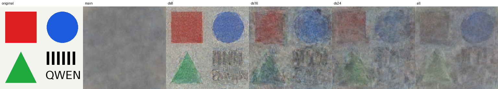
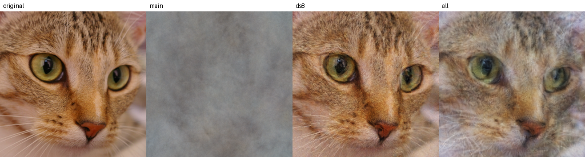
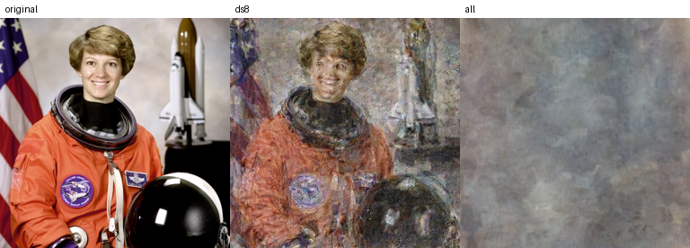
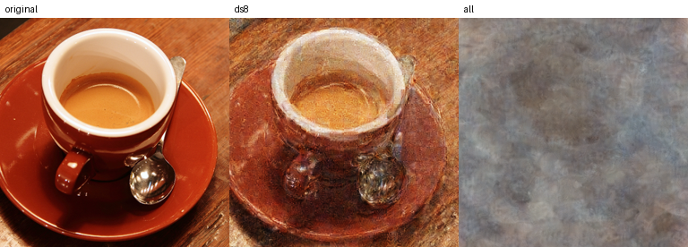

# llm-img-reverse

Running Qwen3-VL-8B's vision stack backwards: given the soft tokens the vision tower produces for an
image, optimize a new image until its soft tokens match them, and look at what comes back.

## What gets inverted

For each 32×32 block of pixels, the vision tower of [Qwen3-VL-8B-Instruct](https://huggingface.co/Qwen/Qwen3-VL-8B-Instruct)
produces four 4096-d vectors, which this repo calls streams:

| stream | where it comes from | where the LLM uses it |
|---|---|---|
| `main` | final merger after all 27 vision blocks | the input embeddings at the image positions |
| `ds8`, `ds16`, `ds24` | DeepStack mergers after blocks 8, 16 and 24 | added to the hidden state after LLM layers 0, 1 and 2 |

`llm_img_reverse/vision.py` loads only the vision tower (0.58B parameters, from shard 4 of the
checkpoint) in fp32. It reproduces the image processor's patch layout as a differentiable function,
which the tests check against `AutoImageProcessor`, and computes any subset of the streams, stopping
the tower at the last block those streams need.

`llm_img_reverse/invert.py` minimizes the relative squared error between the image's tokens and the
targets, summed over the chosen streams with weights. By default it runs L-BFGS over a 1/f-scaled
Fourier spectrum in decorrelated color space (the parameterization from Olah et al., *Feature
Visualization*, 2017). With plain pixels, or with Adam, the result is mostly edges on top of noise.

## Usage

```sh
uv venv && uv pip install torch torchvision --index-url https://download.pytorch.org/whl/cpu
uv pip install -e '.[dev]'
pytest tests

# Invert the test card from its main tokens only (downloads about 2.7 GB of weights on first use).
python -m llm_img_reverse.invert examples/testcard.png --streams main --out results/testcard_main

# Weighted mix of streams, non-square size, and save the target tokens for later.
python -m llm_img_reverse.invert examples/chelsea.png --size 256x320 --streams ds8,main=0.5 \
    --save-tokens chelsea.pt --out results/chelsea

# Invert tokens from a file, such as ones you edited.
python -m llm_img_reverse.invert chelsea.pt --streams all --out results/chelsea_edited
```

Each run writes `reconstruction.png`, `comparison.png` (original next to the reconstruction, for
image inputs) and `metrics.json` (PSNR, and the relative error and mean cosine similarity of every
stream, including those that were not optimized). `--param pixel`, `--optimizer adam`, `--tv` and
`--lr` switch to the baselines and regularizers.

`experiments/cpu_sweep.sh` reruns the CPU tests below, and `experiments/summarize.py` builds the
table and contact sheets from any directory of runs.

## CPU results

Each image at 256×256 (64 soft tokens per stream), 300 L-BFGS evaluations, one run each. The full
table, with every stream's error, is in [`results/cpu/summary.md`](results/cpu/summary.md). "Gray"
is the PSNR of a flat gray image, the score of a reconstruction that recovered nothing.






| image | matched | PSNR (dB) | gray (dB) | main error |
|---|---|---|---|---|
| test card | main | 7.5 | 7.5 | 0.738 |
| test card | ds8 | 10.0 | 7.5 | 0.405 |
| test card | ds16 | 8.0 | 7.5 | 0.181 |
| test card | ds24 | 7.7 | 7.5 | 0.162 |
| test card | all | 7.8 | 7.5 | 0.309 |
| cat | main | 15.2 | 15.0 | 0.645 |
| cat | ds8 | **23.1** | 15.0 | 0.049 |
| cat | all | 17.7 | 15.0 | **0.020** |
| astronaut | ds8 | 12.7 | 9.9 | 0.475 |
| astronaut | all | 10.0 | 9.9 | 0.663 |
| coffee | ds8 | 17.6 | 9.5 | 0.460 |
| coffee | all | 9.7 | 9.5 | 0.523 |

- **DeepStack layer 8 alone gives the image back**, most clearly for photos. The cat's eyes, fur
  and whiskers, the astronaut's face, suit, patch, flag and shuttle, and the coffee cup, spoon and
  wood grain all come back. Contrast is lower than the original, dark areas turn gray, and text
  comes back as unreadable glyph-like marks.
- **Detail fades with depth.** On the test card, ds16 keeps fuzzy shapes and colors and ds24 only
  faint colored blobs.
- **Matching main alone fails from a gray start**: the result stays gray. This is the optimizer,
  not missing information. Images reconstructed from the DeepStack streams match main far better
  than what optimizing main directly finds (test card error 0.16 to 0.41 against 0.74; cat 0.05
  against 0.65). In 100-step trials on the test card, per-token-normalized and cosine losses, Adam
  at learning rates 0.05 and 0.2, and optimizing a 16×16 or 64×64 image upsampled to full size
  did no better.
- **Matching all four streams with equal weights is unreliable.** It reached the lowest main error
  of any run on the cat, but stalled near gray on the astronaut and the coffee.

[`results/probes.md`](results/probes.md), from `experiments/probe_streams.py`, shows what may make
main hard. Adding 2% pixel noise changes main about 2 to 4 times as much as it changes the
DeepStack streams, and 8 of main's 64 tokens hold 40 to 60% of its energy. One explanation, which
these runs have not tested, is that local search finds noise-like changes that move main faster
than real image content does.

## CPU notes

On 4 cores, one forward and backward pass at 256×256 takes about 1.5 s through the whole tower and
about 0.55 s up to block 8, so 300 steps take about 3 minutes for ds8 and 7 to 8 for main or all.
Each run peaks at about 3.4 GB of RAM; four runs at once ran out of memory on a 15 GB machine.
